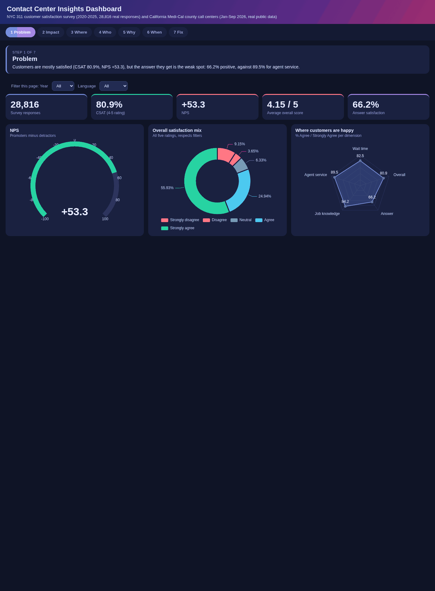
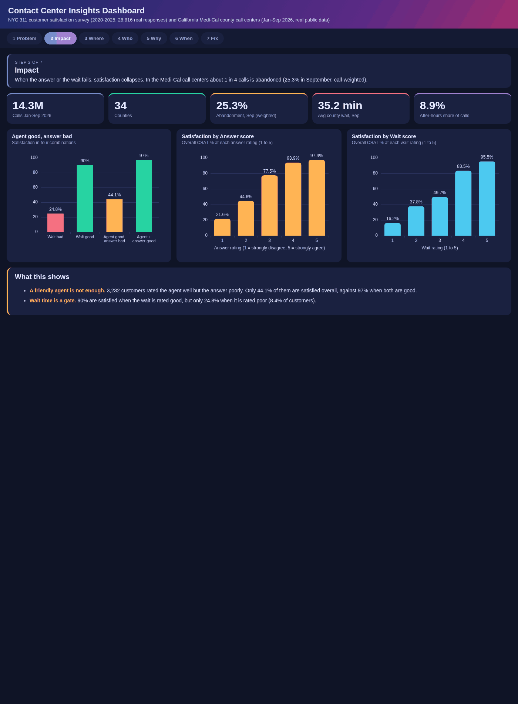
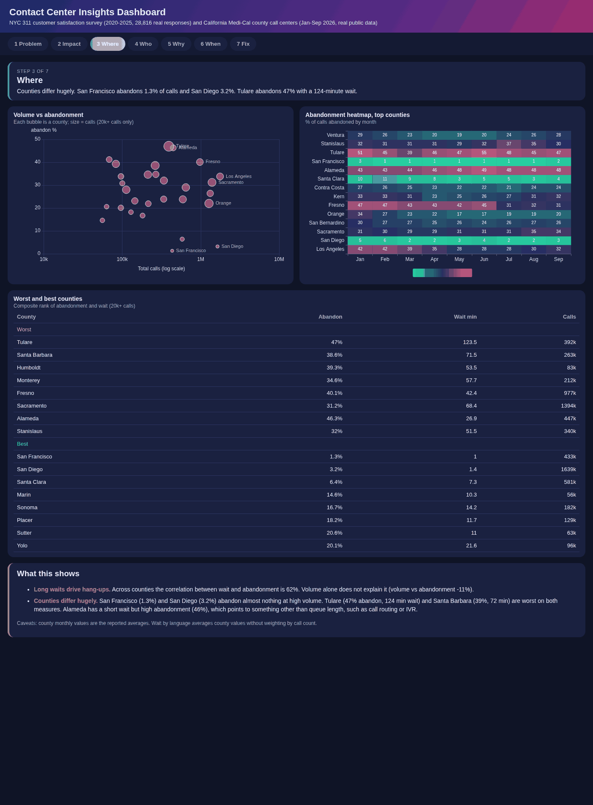
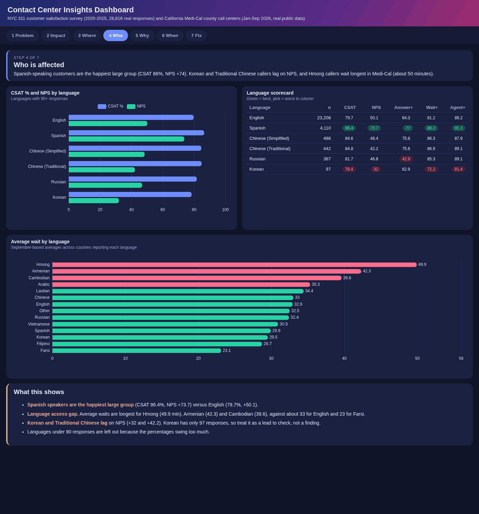
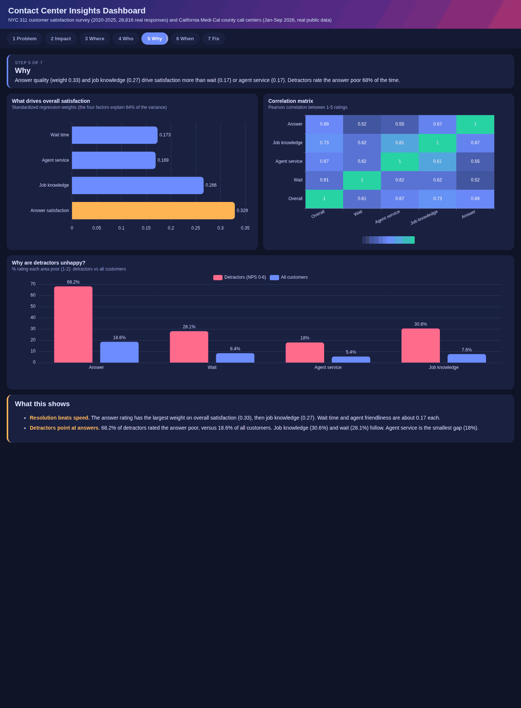
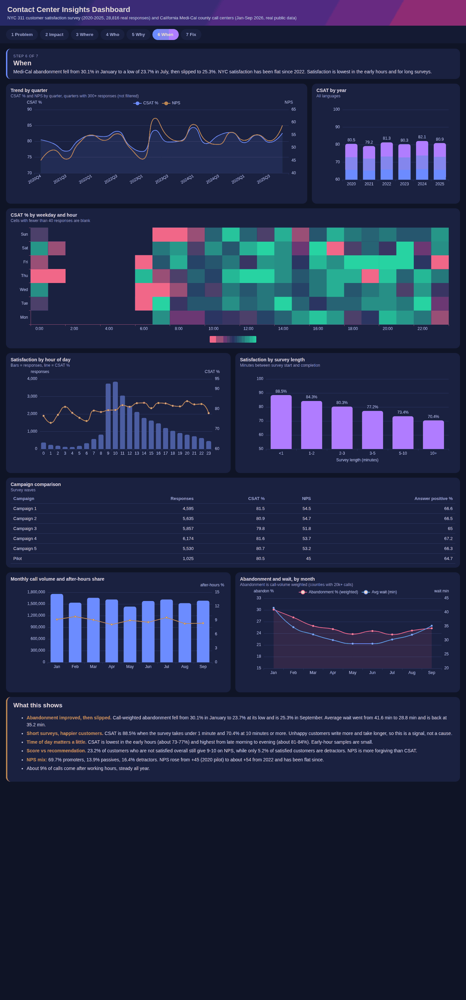

# Contact Center Insights Dashboard

A personal portfolio project: what drives customer satisfaction in a contact center, and where call centers lose callers. Public data only. Not client work.

**Live dashboard:** https://anas-abdelhafeez.github.io/contact-center-insights-dashboard/ (7 tabs in story order, needs internet for the chart library)

## The story (7 tabs)
Problem, Impact, Where, Who, Why, When, Fix.

| Problem | Impact | Where |
|---|---|---|
|  |  |  |

| Who | Why | When | Fix |
|---|---|---|---|
|  |  |  |  |

## Key findings
- CSAT 80.9% and NPS +53.3 across 28,816 survey responses (2020-2025). Answer satisfaction is the weakest score (66.2%), agent service the strongest (89.5%).
- Answer quality is the strongest driver of overall satisfaction (33% weight in the regression), then job knowledge (27%). Wait time and agent service are about 17% each.
- 3,232 customers rated the agent well but the answer poorly. Only 44.1% of them were satisfied, against 97% when both were good.
- Detractors rate the answer poor 68% of the time, against 18.6% of all customers.
- Medi-Cal county call centers, Jan-Sep 2026: about 14.3M calls, 34 counties. 25.3% of calls were abandoned in September (call-weighted). Abandonment tracks wait time (correlation 62%), not call volume.
- Big gaps between counties: San Francisco 1.3% abandonment, Tulare 47% with a 124-minute wait.

## Method
- Cleaned the survey (valid five-point answers, scores 1-5, NPS groups, month, hour, weekday) and aggregated Medi-Cal files by county and month.
- Drivers: Pearson correlations and a standardized linear regression on overall satisfaction (about 64% of variance explained).
- Dashboard: single HTML page with ECharts. Power BI file and Excel workbook cover the same data. SQL playbook for PostgreSQL.

## Data sources and credit
- NYC 311 customer satisfaction survey, 2020-2025 (NYC Open Data). 28,816 responses. No personal data: only ratings, language, timestamps.
- Medi-Cal call center data, California Department of Health Care Services open data (call volume, wait and abandonment by county, Jan-Sep 2026).
- `data/SYNTHETIC_qa_*.csv` are **made-up practice data** for the SQL QA section. They are not real and not linked to any company.
- This repo keeps only a 200-row random sample of the survey (`data/NYC311_survey_sample_200rows.csv`). Full data is at the sources above.

## Files
| Path | What |
|---|---|
| `index.html` | The dashboard (GitHub Pages) |
| `screenshots/` | One screenshot per tab |
| `sql/CSAT_QA_PostgreSQL_playbook.sql` | PostgreSQL queries |
| `excel/Contact_Center_Data_and_Summary.xlsx` | Data and summary workbook |
| `powerbi/Contact_Center_CSAT_Dashboard.pbix` | Power BI report, 7 pages in story order |
| `data/` | Medi-Cal monthly county file, 200-row survey sample, synthetic QA files |

## Honest limits
- Correlations are not causes. Some language groups are small (Korean: 97 responses).
- County wait and abandonment are reported averages, not call-level data.
- **The PBIX was generated with a script and checked by script only. It has not been opened in Power BI Desktop.** It uses basic visuals, so it does not match the HTML dashboard (no gauge, heatmaps, bubble chart or correlation matrix).
- **The SQL playbook was syntax-reviewed only. It has not been run on a live PostgreSQL database.**
- The QA section uses synthetic data only.
- The Pages version loads the ECharts library from a CDN.
